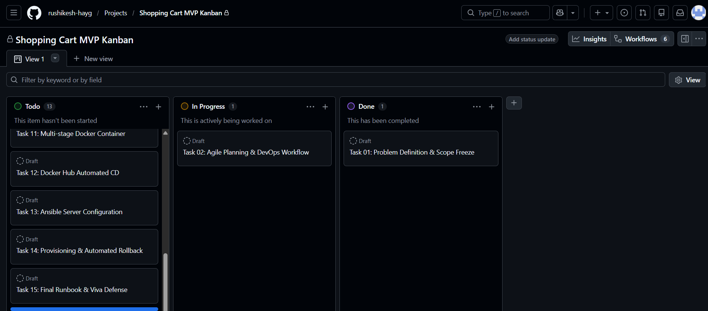

# Task 02: Agile Planning, User Stories, Backlog & DevOps Lifecycle

## 1. Epics, User Stories & Acceptance Criteria

### US-01: Product Catalog Browsing
* **User Story**: As an Online Shopper, I want to browse products with prices and stock levels, so that I can decide what to purchase.
* **Acceptance Criteria**:
  * *Given* the backend API is running, *when* a client requests `GET /api/products`, *then* all seeded catalog items are returned with status `200 OK`[cite: 2, 3].
  * *Given* a search term query `?search=Hoodie`, *when* requested, *then* only products matching the keyword in name or category are returned[cite: 2, 3, 5].

### US-02: Shopping Cart State Management
* **User Story**: As an Online Shopper, I want to add items, modify quantities, and remove items from my cart, so that I can prepare my order accurately before checkout[cite: 2].
* **Acceptance Criteria**:
  * *Given* an item with available stock, *when* added to cart, *then* the cart count badge updates immediately[cite: 2].
  * *Given* items inside the cart, *when* quantity changes, *then* subtotal, 5% sales tax, and final total are recalculated dynamically[cite: 2, 10].
  * *Given* an item quantity reduced below 1, *when* updated, *then* the item is removed from line items[cite: 5].

### US-03: Simulated Checkout & Order Processing
* **User Story**: As an Online Shopper, I want to submit my shipping details and complete a simulated checkout, so that I receive an instant order confirmation[cite: 2].
* **Acceptance Criteria**:
  * *Given* a non-empty cart, *when* customer name and email are submitted via `POST /api/checkout`, *then* a unique Order ID (`ORD-XXXXX`) is generated and stock is decremented atomically[cite: 2, 3, 6].
  * *Given* an empty cart, *when* checkout is attempted, *then* the API returns `400 Bad Request` and blocks submission[cite: 2, 6].

### US-04: Single-Command Container Provisioning
* **User Story**: As an Application Developer, I want to spin up the entire application inside Docker with one command, so that I eliminate manual environment configuration[cite: 2].
* **Acceptance Criteria**:
  * *Given* Docker is installed, *when* running `docker run` or `docker compose up`, *then* the containerized backend runs cleanly on port 5000 and responds healthy[cite: 2, 11].

### US-05: Automated Quality Gate & Continuous Deployment
* **User Story**: As a DevOps Engineer, I want automated regression tests to block deployment upon defect detection, so that broken code never reaches production[cite: 2, 10].
* **Acceptance Criteria**:
  * *Given* an assertion failure in Selenium tests, *when* Jenkins CI runs, *then* the pipeline aborts, captures failure screenshots, and skips deployment[cite: 2, 9, 10].
  * *Given* all tests pass, *when* verified, *then* the container image is tagged, published to the registry, and rolled out without downtime[cite: 2, 12].

---

## 2. 15-Task Product Backlog & Sprint Plan

| Task ID | Task Title | DevOps Domain | Sprint | Story Points | Status |
|---|---|---|---|---|---|
| **Task 01** | Problem Definition, Scope & KPIs | Architecture & Planning | Sprint 1 | 3 | DONE[cite: 1, 2, 6] |
| **Task 02** | Agile Planning, Backlog & DevOps Flow | Agile Methodology | Sprint 1 | 3 | IN PROGRESS[cite: 2] |
| **Task 03** | 3-Tier Architecture & Local Scaffolding | Architecture & Setup | Sprint 1 | 2 | DONE[cite: 2, 6] |
| **Task 04** | Git Repository Setup & Branch Rules | Version Control | Sprint 1 | 2 | DONE[cite: 2, 6] |
| **Task 05** | Feature 1 on Branch: Catalog & Cart | Development & GitFlow | Sprint 1 | 5 | DONE[cite: 2, 6] |
| **Task 06** | MVP Completion, Merge Conflict & v1.0 Tag | Collaboration & Release | Sprint 1 | 5 | DONE[cite: 2, 6] |
| **Task 07** | Jenkins Installation & CI Archive Job | CI Automation | Sprint 2 | 5 | NEXT UP[cite: 6] |
| **Task 08** | Pipeline as Code & Nginx Deployment | CD Automation | Sprint 2 | 3 | PLANNED[cite: 6] |
| **Task 09** | Selenium WebDriver Suite & Local Maven | Automated Testing | Sprint 2 | 5 | PLANNED[cite: 6] |
| **Task 10** | Continuous Testing in Jenkins Quality Gate | Quality Assurance | Sprint 2 | 3 | PLANNED[cite: 6] |
| **Task 11** | Multi-Stage Dockerfile & Lifecycle | Containerization | Sprint 2 | 5 | DONE (Code Ready) |
| **Task 12** | Jenkins-Docker Commit-to-Container CD | Continuous Delivery | Sprint 3 | 5 | PLANNED[cite: 6] |
| **Task 13** | Ansible Server Configuration Playbooks | Configuration Mgmt | Sprint 3 | 3 | DONE (Code Ready)[cite: 16] |
| **Task 14** | Automated Provisioning & 5s Rollback SLA | Reliability & Recovery | Sprint 3 | 3 | DONE (Code Ready)[cite: 16] |
| **Task 15** | Final Release, Runbook & Viva Ready | Release & Governance | Sprint 3 | 2 | PLANNED[cite: 6] |

---

## 3. Kanban Task Board Snapshot



---

## 4. Definition of Done (DoD) Checklist

No task is marked as **DONE** unless it strictly satisfies every item in this checklist[cite: 2]:
1. **Functional Acceptance**: Code implements the specified user story logic and passes manual verification[cite: 2].
2. **Automated Testing**: Unit tests and Selenium regression tests pass with zero failures[cite: 2].
3. **Docker Standards**: Dockerfiles build using multi-stage targets, run as non-root user `node`, and remain lightweight (< 100 MB)[cite: 1, 2, 11].
4. **Security Compliance**: Zero committed secrets or database binaries in Git history (`.gitignore` active)[cite: 1, 2, 4].
5. **Orchestration Stability**: Containers start healthy and report valid status via `/api/health` probes[cite: 2, 11].
6. **Technical Documentation**: Each deliverable has corresponding Markdown documentation and clean Conventional Commits[cite: 2, 4].

---

## 5. End-to-End DevOps Lifecycle Architecture

```
+---------------------------------------------------------------------------------------------------------+
|                                DEVOPS CONTINUOUS LIFECYCLE FOR SHOPPING CART                            |
+---------------------------------------------------------------------------------------------------------+
|                                                                                                         |
|   [ 1. PLAN ]   ======>   [ 2. CODE ]   ======>   [ 3. BUILD ]   ======>   [ 4. TEST ]                  |
|   * Tasks 01, 02          * Tasks 03, 04, 05, 06  * Tasks 07, 11            * Tasks 09, 10              |
|   * User Stories          * Feature branches      * Multi-stage Docker      * Selenium TestNG suite     |
|   * Product Backlog       * Express & SQLite APIs * Minimal Alpine image    * Headless Chrome checks    |
|   * DoD Agreement         * Git Conventional Msg  * Clean layer caching     * Failure screenshots       |
|                                                                                    ||                   |
|                                                                                    \/                   |
|   [ 8. MONITOR ] <======  [ 7. OPERATE ] <======  [ 6. DEPLOY ] <======  [ 5. RELEASE ]                 |
|   * Task 15               * Tasks 13, 14          * Tasks 08, 12            * Tasks 06, 12              |
|   * Healthcheck probes    * Ansible idempotency   * Container replacement   * Semantic Git Tagging      |
|   * Troubleshooting       * Auto-restart policy   * Volume mount (/data)    * Push to Docker Hub        |
|   * Runbook audit         * 5s instant rollback   * Zero-downtime rollout   * Build fingerprinting      |
|                                                                                                         |
+---------------------------------------------------------------------------------------------------------+
```
